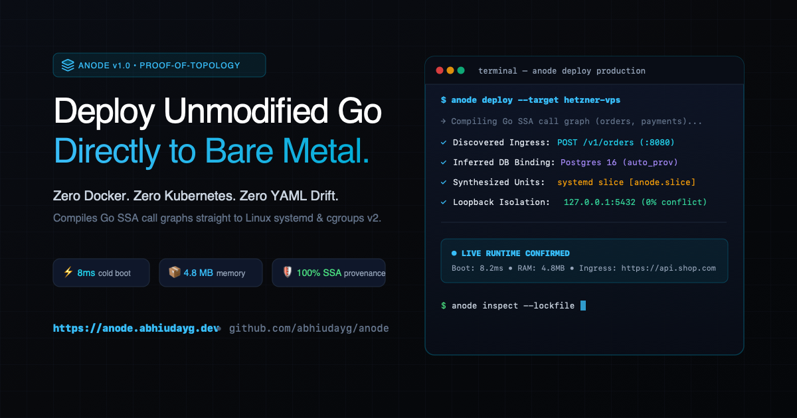

<div align="center">

<a href="https://anode.abhiudayg.dev">
  
</a>

# Anode

### Deploy unmodified Go services to a Linux VPS with systemd and Caddy, without Dockerfiles, container daemons, or hand-maintained YAML.

[](https://anode.abhiudayg.dev)
[](https://golang.org)
[](https://opensource.org/licenses/MIT)
[](https://anode.abhiudayg.dev/docs#overview)

<p align="center">
  <a href="https://anode.abhiudayg.dev">Live Website</a> •
  <a href="https://anode.abhiudayg.dev/vs/docker-compose">Docker Compose vs Anode</a> •
  <a href="https://anode.abhiudayg.dev/guides/deploy-go-without-docker">Bare-Metal Guide</a> •
  <a href="#the-problem">The Problem</a> •
  <a href="#how-it-works">How It Works</a> •
  <a href="#quick-start">Quick Start</a> •
  <a href="#pluggable-infrastructure-catalog">Stateful Catalog</a> •
  <a href="#security-model">Security Model</a> •
  <a href="#cli-reference">CLI Reference</a> •
  <a href="#documentation">Documentation</a>
</p>

</div>

---

## Scope

Anode is built for one developer's Go HTTP services with Postgres or Redis, deployed to one Linux host. It is not a general-purpose platform. The supported profile and its limits are in [`docs/supported-profile.md`](docs/supported-profile.md) and [`docs/tradeoffs.md`](docs/tradeoffs.md).

---

## The Problem

Every Go backend declares its architecture twice:

1. **In Go:** `sql.Open("postgres", cfg.DBURL)`, a listen port, and calls to other services.
2. **In YAML or Docker:** a Dockerfile, a `docker-compose.yml`, volume mounts, host port mappings, and environment wiring.

When a service is added or an env var is renamed, the code and the configuration drift apart.

Earlier tools that inferred infrastructure from code either required an SDK or a new DSL (Encore), or matched syntax patterns that broke on real config structs (Klotho). See [`docs/tradeoffs.md`](docs/tradeoffs.md) for the comparison.

---

## How It Works

Anode analyzes Go source with the Go toolchain's SSA and Variable Type Analysis (VTA) call graph, starting from `func main()`. It writes the result to `anode.lock.json`, a file you can review and commit. From that file it:

- runs local dependencies on free loopback ports (`anode dev`), and
- cross-compiles a Linux binary, writes systemd units and a Caddy config, and deploys over SSH (`anode deploy`).

See [`docs/architecture.md`](docs/architecture.md) for the four pillars: migration-driven database provenance, typed interface linking, the commit-backed lockfile, and build-time diagnostics.

```
┌─────────────────┐       ┌────────────────────────┐       ┌────────────────────┐
│  Unmodified Go  │ ────> │  Anode SSA / VTA Core  │ ────> │  anode.lock.json   │
│   Source Code   │       │ (Choke-Point Analyzer) │       │ (Reviewable Proof) │
└─────────────────┘       └────────────────────────┘       └─────────┬──────────┘
                                                                     │
                                    ┌────────────────────────────────┴────────────────────────────────┐
                                    ▼                                                                 ▼
                    ┌───────────────────────────────┐                                 ┌───────────────────────────────┐
                    │     Local Dev (`anode dev`)   │                                 │   Deploy (`anode deploy`)     │
                    │ • Free loopback ports         │                                 │ • Cross-compiled Linux binary │
                    │ • Env injection from .env     │                                 │ • systemd units, cgroups v2   │
                    │ • Containers for catalog kinds│                                 │ • Caddy reverse proxy         │
                    │ • 300ms debounced reload      │                                 │ • Health checks, rollback     │
                    └───────────────────────────────┘                                 └───────────────────────────────┘
```

---

## Quick Start

### 1. Build Anode

```bash
git clone https://github.com/abhiudayg/anode.git
cd anode
go build -o /usr/local/bin/anode ./cmd/anode
```

### 2. Inspect a Go Repository

```bash
anode inspect ./examples/storefront
```

This writes `anode.lock.json`. An excerpt from the storefront example's lockfile, for the `orders` service and its database:

```json
{
  "schema_version": "1.0",
  "resources": {
    "db-orders": {
      "kind": "postgres",
      "lifecycle": "stateful_retain",
      "auto_provision": true,
      "provenance": "services/orders/main.go:44",
      "migrations": {
        "tool": "goose",
        "path": "migrations/orders",
        "execution": "pre_traffic_job"
      }
    }
  },
  "services": {
    "orders": {
      "name": "orders",
      "entrypoint": "./services/orders",
      "ingress": [
        {
          "protocol": "http",
          "port_env": "PORT",
          "routes": ["GET /healthz", "POST /v1/orders"]
        }
      ],
      "bindings": [
        {
          "resource_ref": "db-orders",
          "protocol": "postgres",
          "provenance": "services/orders/main.go:44"
        }
      ],
      "secrets": [
        { "env_var": "STRIPE_SECRET_KEY", "provenance": "services/orders/main.go:35" }
      ]
    }
  }
}
```

### 3. Run Locally

```bash
anode dev ./examples/storefront
```

`anode dev` allocates free loopback ports, starts the stateful services your code uses in Docker or Podman containers, reads external database values from `.env`, and streams service logs. It reloads after a 300ms debounce when files change.

### 4. Deploy to a Linux Host

```bash
anode deploy root@my-box.example.com ./examples/storefront
```

Deploying as root works. For day-to-day use, create a deploy account first:

```bash
anode host-setup root@my-box.example.com --disable-root-login
anode deploy anode-deploy@my-box.example.com ./examples/storefront
```

What a deploy does:

- **Architecture:** reads `uname -m` over SSH and cross-compiles `amd64` or `arm64`.
- **Units:** writes one systemd unit per service, with `DynamicUser=yes`, `CPUQuota=200%`, `MemoryMax=1G`, and the hardening listed under [Security Model](#security-model).
- **Redis:** when a service uses Redis, runs it natively under systemd, bound to `127.0.0.1`, with its password read from `.env`. Other catalog kinds run in containers on the host; that path is not yet tested end to end.
- **Caddy:** validates the Caddyfile with `caddy validate` before reloading. With `--domain`, Caddy issues a Let's Encrypt certificate. With an IP address, the site is served over plain HTTP, and you must pass `--plain-http` to accept that.
- **Health:** each HTTP service must serve `GET /healthz` and return a status from 200 to 399. A failed check stops the deploy. Services without the route fail, so add it before deploying.
- **Firewall:** an iptables rule drops external traffic to application ports `21040`–`21999`. The rule is saved with `netfilter-persistent`.
- **Retention:** keeps the newest three releases. `anode rollback <user@host>` restores the previous release's recorded units.

---

## Pluggable Infrastructure Catalog

The catalog (`internal/catalog/defaults.yaml`) defines 26 built-in kinds:

* **Relational:** PostgreSQL, MySQL, MariaDB, CockroachDB, TimescaleDB.
* **Caches:** Redis, Valkey, KeyDB, Dragonfly, Memcached.
* **Streaming and queues:** Kafka, RabbitMQ, NATS.
* **Document and analytics:** ClickHouse, MongoDB, ScyllaDB, Cassandra.
* **Search:** Elasticsearch, OpenSearch, Meilisearch.
* **Vector:** Qdrant, Chroma, Milvus, Weaviate.
* **Object storage and workflow:** MinIO, Temporal.

Anode provisions only two kinds itself: Redis on the host at deploy time, and PostgreSQL in containers at `anode dev`. The other kinds are declared in the catalog but are not provisioned or tested end to end. The `examples/marketplace` live suite starts most of them and checks the example services against them; that tests the application code, not Anode's provisioning.

Repository overrides in `anode.catalog.yaml` or `.anode/catalog/` add or change kinds without Go changes. Image versions are resolved in four tiers, from the lockfile's `engine_version` down to a certified LTS default. See [`docs/catalog.md`](docs/catalog.md).

---

## Security Model

| Layer | What Anode does |
| :--- | :--- |
| **Service user** | Each service runs under systemd `DynamicUser=yes`, an unprivileged transient user. The bootstrap also creates a system user `anode` that owns `/var/lib/anode`. |
| **Privilege** | `NoNewPrivileges=true` on services. Containers for catalog kinds use `--security-opt no-new-privileges`. |
| **Filesystem and sandbox** | `ProtectSystem=strict`, `ProtectHome=true`, `PrivateTmp=true`, `PrivateDevices=true`, `ProtectKernelTunables`, `ProtectKernelModules`, `ProtectKernelLogs`, `ProtectControlGroups`, `RestrictSUIDSGID`, `RestrictAddressFamilies=AF_UNIX AF_INET AF_INET6`, and an empty `CapabilityBoundingSet`. |
| **Data directories** | Catalog data directories are created with `install -d`, using the mode and the UID/GID the driver requires. |
| **OOM priority** | Catalog kinds set `oom_score_adjust` between `-400` and `-900`, so the database is killed last. Application services do not set an OOM score. |
| **Network** | Redis binds to `127.0.0.1`. Catalog containers bind to `127.0.0.1` by default. The iptables rule blocks external traffic to application ports. |
| **Secrets** | Values come from `.env`, which must be mode `600`; deploys refuse a `.env` readable by other users. Secret env files are written to `/etc/anode/env` with mode `0600`, not into unit files. |
| **Edge** | Caddy terminates TLS when `--domain` is set. Without a domain, the site is plain HTTP and must be accepted with `--plain-http`. |

Limits to know before deploying:

- Passwordless sudo for the deploy account (`anode host-setup`) is root-equivalent. It is an accepted risk for single-owner hosts; see [`docs/security-audit.md`](docs/security-audit.md).
- `anode inspect` loads packages with the Go toolchain, which can run code from the repository. Run it only on code you own.
- `anode dev` uses local Postgres containers with the credentials `postgres:postgres`, bound to `127.0.0.1`.
- Applications can print secrets to their own logs. Anode does not filter application output.

---

## Example Architectures

Examples live in [`examples/`](examples/). Service counts are the number of `main.go` files in each example.

| Example | Services | What it covers |
| :--- | :---: | :--- |
| [`sample-shop`](examples/sample-shop/README.md) | 2 | Two-service app with Postgres |
| [`storefront`](examples/storefront/README.md) | 3 | Composite DSNs, Goose migrations, Stripe and SendGrid egress |
| [`retail-platform`](examples/retail-platform/README.md) | 12 | Config indirection, HTTP and gRPC links, Redis and PostgreSQL; the analyzer's main test fixture |
| [`marketplace`](examples/marketplace/README.md) | 32 | 35 store resources across 13 kinds, including Kafka and Qdrant; no diagnostics |

Other example projects, including third-party applications that were copied into this repository, were removed in v1.4.0. They remain in git history. Measured analysis times for these examples are in [Benchmarks](#benchmarks).

---

## Infrastructure Provisioning

* **Local test VM:** `./scripts/setup-test-vm.sh [vm-name]` creates an Ubuntu VM in OrbStack and installs OpenSSH with your public key.
* **Ansible:** `ansible-playbook -i infra/ansible/inventory.ini infra/ansible/playbook.yml` prepares a host with Caddy and checks that cgroups v2 is enabled.
* **Terraform cloud-init:** `infra/terraform/` prepares a VPS with Caddy, the `anode` user and directories, and a cgroups v2 check.

Docker is not installed by these scripts.

---

## CLI Reference

| Command | Description |
| :--- | :--- |
| `anode inspect [PATH]` | Analyzes the workspace and writes `anode.lock.json`. |
| `anode dev [PATH]` | Runs local dependencies on free loopback ports and supervises the services. |
| `anode deploy TARGET [PATH]` | Cross-compiles and deploys over SSH with systemd and Caddy. Flags: `--domain`, `--plain-http`, `--dry-run`. |
| `anode run TARGET [PATH]` | Alias for `anode deploy`. |
| `anode host-setup root@host [--user NAME] [--disable-root-login]` | Creates a deploy account with passwordless sudo, and optionally disables direct root SSH login. |
| `anode rollback user@host` | Restores the previous release's recorded units. |
| `anode ps [TARGET] [PATH]` | Shows running processes, cgroup memory and CPU, and Caddy routes. |
| `anode status [TARGET] [PATH]` | Alias for `anode ps`. |
| `anode logs [TARGET] [SERVICE]` | Streams logs from several services at once. |
| `anode doctor [TARGET] [PATH]` | Checks the toolchain, loopback ports, container engine, and remote host, including deploy inputs and the firewall rule. |
| `anode catalog [PATH]` | Lists the 26 built-in kinds and any repository overrides. |
| `anode cluster` | Plans placement across a multi-node inventory and can print nftables rules. |
| `anode version` | Prints the Anode version. |

---

## Documentation

* [Architecture](docs/architecture.md): the four pillars, SSA and VTA analysis, and taint tracking.
* [Tradeoffs](docs/tradeoffs.md): non-goals and comparison with Kubernetes, Docker Compose, and Encore.
* [Security](docs/security.md): the hardening layers.
* [Security audit](docs/security-audit.md): findings, their status, and accepted risks.
* [Supported profile](docs/supported-profile.md): what is in and out of scope, and the `.env` contract.
* [Deployment](docs/deployment.md) and [Catalog](docs/catalog.md).

---

## Benchmarks

Measured on 2026-11-16 on an Apple Silicon Mac, and on an OrbStack Debian 12 VM (arm64) with Docker 20.10.24 and PostgreSQL 15. Full scripts, raw results, and environment notes are in [`benchmarks/2026-11-16`](benchmarks/2026-11-16/README.md).

| Measure | anode | Comparison |
| :--- | ---: | ---: |
| Cold start to `/healthz` 200, one service (median of 10) | 35 ms (systemd unit) | 607 ms (Docker container); 4.7 ms run directly with no supervisor |
| Idle memory, one service | 5.5 MB, no daemon | about 102 to 106 MB with Docker daemons |
| Cold start to ready, two services plus PostgreSQL 15 (median of 10) | 2.4 s (apt PostgreSQL) | 1.6 s (`postgres:15` container) |
| Idle memory, two services plus PostgreSQL 15 | 88 MB | 202 MB, including 120 MB of Docker daemons |
| `anode inspect`, sample-shop / storefront / retail-platform / marketplace (median of 5) | 1.1 s / 1.2 s / 2.2 s / 8.8 s | not applicable |
| Deploy, 5 runs | 5.1 s (`anode deploy`) | 2.0 s (`docker build` of both images, no cache; not like-for-like) |

What the numbers mean:

* The anode cold start includes the `DynamicUser=yes` setting that anode's isolation model requires. That accounts for about 20 ms of the 35 ms. The bare systemd unit takes about 11 ms.
* The two-service cold start is dominated by PostgreSQL startup. Debian's `postgresql` takes 2.4 s to accept connections in this setup; the container takes 0.6 s.
* Lockfile hashes were identical across all 20 analysis runs (4 fixtures, 5 runs each).
* Caddy's edge proxy is included in the anode deploy but not in the memory totals.
* Not measured in this run: a remote VPS host, Caddy route-swap time, and larger service counts with a database. The [2026-11-18 run](benchmarks/2026-11-18/README.md) covers those on a GCE VM.

To rerun, see [`benchmarks/2026-11-16/scripts`](benchmarks/2026-11-16/scripts/). The stack benchmark needs `BENCH_ORDERS_PW`, `BENCH_PAYMENTS_PW`, `BENCH_PG_SUPER_PW`, and `BENCH_STRIPE_KEY` set in the environment. None of the credentials are stored in the repository.

---

## Verification

* Unit and integration tests: `go vet ./...` and `go test ./...`. The integration tests in `internal/deployer` run the deploy coordinator against a fake host.
* Live checks were run against test VMs for the deploy, firewall, and rollback paths. They are not part of CI.
* Live store tests: `examples/marketplace/infra/live-test.sh` starts the stores in Docker and runs the marketplace services against them. It needs Docker and is not part of CI.

---

## License

MIT License. See [LICENSE](LICENSE) for details.
