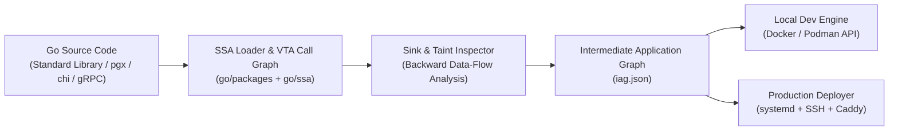

# anode

[](https://golang.org)
[](https://opensource.org/licenses/MIT)

**Application-Centric Orchestrator & Topology Compiler (Infrastructure-from-Code without SDK lock-in).**

Deploy unmodified standard Go microservices to Linux VPS / bare-metal hosts with **zero Dockerfiles, zero Kubernetes YAML, and zero custom SDK imports**.

---

## The Core Thesis: "Graph-Driven Orchestration"

Instead of forcing developers to write and maintain brittle infrastructure files:
```text
YAML / HCL -> API Server -> Etcd -> Container Runtime
```

`anode` analyzes your actual application source code via static single-assignment (SSA) compiler IR and variable-type call graphs to extract an **Intermediate Application Graph (IAG)**:
```text
Source Code -> Compiler / SSA Analyzer -> Intermediate Application Graph (IAG) -> Runtime Reconciler
```

---

## Key Principles

1. **Zero SDK Lock-In:** Write standard Go code using standard libraries (`net/http`, `database/sql`, `pgx`, `grpc-go`). If you stop using `anode`, your code requires zero refactoring.
2. **Compiler-Grade Precision (No Regex / No AST Guesswork):** Built on `golang.org/x/tools/go/packages`, `go/ssa`, and **Variable Type Analysis (VTA)** call graphs rooted at `func main()`.
   - **Dead Code Pruning:** Uncalled drivers and helpers are mathematically pruned before infrastructure is emitted.
   - **Field-Sensitive Backward Taint Tracking:** Traces dynamic connection strings and environment variables across function boundaries and struct allocations.
3. **PaaS Simplicity on $5–$40 Bare Metal / VPS:** Deploy to any Linux server over SSH (`systemd`, cgroups v2, dynamic loopback routing, automatic Let's Encrypt TLS) without Kubernetes overhead.

---

## Architecture Pipeline



---

## Intermediate Application Graph (`iag.json`)

Running `anode inspect` emits a deterministic topology graph detailing services, ingress routes, stateful database dependencies, and secrets with exact source code provenance:

```json
{
  "schema_version": "1.0",
  "resources": {
    "db-orders": {
      "kind": "postgres",
      "lifecycle": "stateful_retain",
      "provenance": "orders/main.go:40"
    },
    "db-payments-db": {
      "kind": "postgres",
      "lifecycle": "stateful_retain",
      "provenance": "payments/main.go:31"
    }
  },
  "services": [
    {
      "name": "orders",
      "entrypoint": "./orders",
      "ingress": [
        {
          "protocol": "http",
          "port_env": "PORT",
          "routes": [
            "POST /v1/orders"
          ]
        }
      ],
      "bindings": [
        {
          "resource_ref": "db-orders",
          "protocol": "postgres",
          "inject_env": "ORDERS_DB_URL",
          "provenance": "orders/main.go:40"
        }
      ],
      "secrets": [
        {
          "env_var": "STRIPE_SECRET_KEY",
          "provenance": "orders/main.go:27"
        }
      ]
    }
  ]
}
```

---

## Installation & CLI Usage

### Build from Source

```bash
git clone https://github.com/abhiudayg/anode.git
cd anode
go build -o anode ./cmd/anode
```

### Commands

* **`anode inspect [path]`**: Statically analyze a Go repository or monorepo and emit the formatted `iag.json`.
  ```bash
  anode inspect ./testdata/sample-shop
  ```
* **`anode dev`** *(Phase 2 - In Progress)*: Auto-provision local dependencies (Postgres/Redis), inject dynamic connection strings, run database migrations, and watch for hot-reloads.
* **`anode deploy <user@host>`** *(Phase 3)*: Cross-compile static Linux binaries, provision remote systemd services, configure zero-downtime swaps, and issue automatic TLS certificates.

---

## Project Roadmap

| Phase | Milestone | Status |
| :--- | :--- | :---: |
| **Phase 1** | **Compiler Core (`anode inspect`)**: SSA loader, VTA call-graph reachability, backward taint tracking for structs/env, and IAG schema v1. | **Complete** |
| **Phase 2** | **Local Zero-Config Dev (`anode dev`)**: Docker-backed state provisioner, automated schema migration execution (`goose`/SQL), and sub-500ms watch loop. | In Progress |
| **Phase 3** | **Single-Host Production (`anode deploy`)**: SSH bootstrap, systemd unit generation, zero-downtime port swaps, and automatic Let's Encrypt TLS. | Planned |
| **Phase 4** | **Invisible Elasticity**: Multi-host pooling, automated WAL S3 backups, and compiler-generated eBPF/nftables zero-trust policies. | Planned |

---

## License

MIT License. See [LICENSE](LICENSE) for details.
